<div align="center">

# 📡 AI 新物种猎手雷达 · AI Tech Radar

**5 源无词捕获 · 书签收藏比提纯 · 评论区一楼穿透 · TypeSafe Jev 硬核终审 · 按需中文提炼**

<p>
  <a href="./README.md"></a>
  <a href="./README_EN.md"></a>
</p>

<p>
  
  
  
  <a href="./LICENSE"></a>
</p>

</div>

---

## 🎯 项目简介：为什么做这个雷达？

每天在 X (Twitter)、GitHub、HuggingFace、Reddit 上找真正好玩的 **AI 新模型、开源权重、生图/视频/语音工作流、低显存黑科技和极客野生项目**，传统的「关键词搜索」和普通 RSS 几乎完全失灵：

1. **80% 的野生神作不写公关词**：独立开发者随手发一句 *"Weekend hack: running full macOS GUI inside terminal with Claude"* 就火了，根本不会带 `Introducing / Announcing` 这类套话。
2. **X 平台外链降权导致「链接全藏在一楼评论区」**：为了躲避算法限流，博主普遍在主贴只放演示视频，把真正的 GitHub / HuggingFace 链接扔进自己的第一条回复里——普通采集器扫回来全是没链接的半截贴。
3. **水贴与标题党泛滥**：互动量高不代表有干货，「震惊体」和 Waitlist 营销号淹没了真正给代码、给权重的硬核项目。

**AI Tech Radar** 用一套 **四层漏斗架构** 彻底解决上面三个痛点：不靠死板关键词猜，直接从 **5 大源头** 抓高信号候选、自动穿透一楼评论区抠回隐藏仓库链接、用 **TypeSafe Jev** 做四维结构化裁判剔除水贴，最后交给你在清爽的双语界面里按需点译和归档。

---

## 🧠 四层漏斗工作流

```mermaid
flowchart LR
    subgraph L1["第一层：5 源无词捕获"]
      S1["𝕏 推荐流 / 关注流 / 热词反查"]
      S2["🤗 HuggingFace 实时飙升榜"]
      S3["📦 GitHub 近12天暴涨新库"]
      S4["👽 Reddit 三大AI社区热帖"]
      S5["🟧 Hacker News Show HN"]
    end

    subgraph L2["第二层：初筛提纯 & 链接穿透"]
      R1["书签收藏率 (Bookmarks/Likes) 算分"]
      R2["跨平台同仓库指纹合并加权"]
      R3["X 主贴无链接 → 自动穿透一楼评论区抠链接"]
    end

    subgraph L3["第三层：TypeSafe Jev 终审"]
      J1["新入库帖子绝对优先送审 (余量补评旧帖)"]
      J2["四维结构化打分：赛道 / 可玩度 / 硬核分 / 噱头率"]
      J3["自动拦截 NOISE 水贴与纯营销号"]
    end

    subgraph L4["第四层：双语终端 & 按需翻译"]
      U1["时间窗过滤 (24h / 近3天 / 近7天 / 全部)"]
      U2["本地流式音视频防盗链代理 (/api/media)"]
      U3["单卡点译 / 本页批量译 (DeepSeek) · 原/译秒切"]
    end

    L1 --> L2 --> L3 --> L4
```



---

## ✨ 核心特性

| 模块 | 实战能力说明 |
| :--- | :--- |
| **🌐 5 源实时共振** | 覆盖 **𝕏（为你推荐 + 正在关注 + 热榜词反向搜索）**、**HuggingFace Trending（模型 + Space）**、**GitHub 暴涨新库**、**Reddit（`r/LocalLLaMA` + `r/StableDiffusion` + `r/comfyui`）**、**HN `Show HN`**；同一仓库跨平台出现自动合并徽章并提权。 |
| **🕵️ 评论区一楼穿透** | 自动识别无直链的高信号 X 新帖，调用 `TweetDetail` 进作者一楼回复把藏起来的 GitHub / HuggingFace / Space 链接抠出来挂到卡片底部（已入库老帖自动跳过，不重复查）。 |
| **⚖️ Jev 裁判 + 新帖优先** | 调用官方 `typesafe-sdk` 对赛道（生图视频音频3D / 开源权重 / 低显存算力 / 野生项目 / Agent工具）、可玩度（立即可玩 vs 论文演示）和实用分打分；**每次扫描优先评新入库帖子**，剩余名额再补评历史积压，绝不重复计费。 |
| **⏱️ 时间窗防老帖霸屏** | 内置 **24小时内 / 近 3 天（默认） / 近 7 天 / 全部历史** 时间过滤，配合 **Jev 分数严格高→低 / 综合爆款度 / 干货收藏比 / 最新时间** 四种排序，保证每天打开第一页都是新鲜硬货。 |
| **🈶 零浪费按需手动翻译** | 扫描过程**零翻译 Token 消耗**；看中单张外文卡点 **`🌐 译`** 1 秒出中文标题与硬核看点，或点 **`🌐 翻译本页`** 打包翻完当前页（每页 10 条），结果永久存库且支持 **`原 / 译`** 零延迟来回切换。 |
| **🎬 流式媒体防裂图代理** | 内置 `/api/media` 本地流式代理（支持视频 `HTTP 206 Range` 拖动播放与系统代理自动穿透），彻底解决浏览器直连 X 视频或 Reddit 预览图防盗链黑屏/裂图问题。 |
| **🔀 全站中英双语界面** | 网页右上角支持一键切换 **`中文 / EN`** 界面语言（默认中文，自动记忆偏好）。 |

---

## 🚀 3 分钟快速上手手册（Quickstart）

### 1. 环境准备
- **Python 3.10+**（Windows / macOS / Linux 均可）
- 如在国内网络环境访问 X / HuggingFace / Reddit，请保持本地系统代理开启（程序会自动识别系统代理，无需手填端口）。

### 2. 一键启动

**Windows 用户（推荐）：**
直接双击项目根目录下的 **`start-ai-radar.bat`**（首次运行会自动创建 `.venv` 虚拟环境、安装依赖、生成 `.env` 并自动在浏览器打开 `http://127.0.0.1:8096`）。

**命令行启动（Windows / macOS / Linux）：**
```bash
# 1. 克隆仓库
git clone https://github.com/lufeihb1996/AI-Tech-Radar.git
cd AI-Tech-Radar

# 2. 创建虚拟环境并安装依赖
python -m venv .venv
# Windows PowerShell:
.\.venv\Scripts\pip install -r requirements.txt
# macOS / Linux:
# ./.venv/bin/pip install -r requirements.txt

# 3. 复制配置文件模板
cp .env.example .env

# 4. 启动服务
# Windows PowerShell:
.\.venv\Scripts\python -m uvicorn app.main:app --host 127.0.0.1 --port 8096
# macOS / Linux:
# chmod +x start-ai-radar.sh && ./start-ai-radar.sh
```
启动后浏览器访问：**http://127.0.0.1:8096**

---

### 3. 配置密钥与 Cookie（支持网页弹窗直接保存）

打开网页右上角点击 **「⚙️ 密钥 / Cookie 配置」**（或直接编辑项目根目录 `.env` 文件，留空项不会覆盖已有配置）：

1. **TypeSafe Jev API Key（推荐，用于硬核打分与去水贴）**
   - 前往 [console.typesafe.ai](https://console.typesafe.ai) 获取 `apikey_...` 填入（未填时会自动降级为本地启发式规则打分，不影响基础使用）。
2. **X (Twitter) 登录 Cookie（启用 𝕏 数据源必填；不填仍可正常扫另外 4 个免登录源）**
   - 浏览器打开已登录的 [x.com](https://x.com) -> 按 `F12` 打开开发者工具 -> 切到 **Application（应用）** -> 左侧点 **Cookies -> `https://x.com`**；
   - 复制 **`auth_token`**（40 位字符）和 **`ct0`**（160 位字符）粘入弹窗保存即可。
3. **OpenRouter API Key（用于手动点击中文翻译）**
   - 前往 [openrouter.ai/keys](https://openrouter.ai/keys) 创建 `sk-or-v1-...` 填入，后台默认调用高性价比极速模型 `deepseek/deepseek-v4-flash`（翻 100 条仅需约 \$0.02）。

---

## 📖 日常高效使用指南

1. **按源头即勾即看**：顶部 5 个数据源复选框既是**下方卡片的实时筛选器**，也是点击扫描时的**抓取范围**。只想看 GitHub 暴涨新库？只保留勾选 `📦 GitHub` 即可秒筛。
2. **每日一扫**：点击 **「⚡ 立即扫描已勾选源」**，约 10~15 秒拉回最新动态并优先完成今日新帖的 Jev 精判（老帖自动去重更新热度，不重复扣费、不重生成卡片）。
3. **先筛后译，极致省流**：
   - 默认时间窗为 **「近 3 天」** + **「按 Jev 分数 (高 → 低)」**，每页精简显示 10 条；
   - 看到感兴趣的英文卡片点右上角 **`🌐 译`**（1 秒单条提炼），或者点顶部 **`🌐 翻译本页 (X条)`** 整页打包翻完；
   - 已译卡片右上角可随时点 **`原` / `译`** 在英文原帖与中文提炼之间无损切换；好项目点 **`☆ 收藏`** 永久收进收藏夹（不受时间窗限制）。

---

## 📂 项目目录结构

```text
AI-Tech-Radar/
├── app/
│   ├── api/
│   │   └── routes.py              # REST API：扫描编排、分页查询、手动翻译、流式媒体代理
│   ├── core/
│   │   ├── config.py              # .env 配置加载与系统代理自动探测
│   │   └── database.py            # SQLite 双指纹去重合并、新帖优先待判队列、多维分页查询
│   ├── data/                      # 本地 SQLite 数据库目录 (ai_radar.db 已被 Git 忽略保护隐私)
│   ├── services/
│   │   ├── x_ingestor.py          # X GraphQL 动态发现、推荐/关注流抓取、一楼评论区链接穿透
│   │   ├── external_ingestors.py  # HuggingFace / GitHub / Reddit RSS / HN Show HN 采集器
│   │   ├── ranker_service.py      # 书签收藏率初筛打分、外链识别与跨平台项目名归并
│   │   └── jev_judge_service.py   # 官方 TypeSafe Jev 四维裁判 & DeepSeek 中文看点提炼
│   ├── static/
│   │   ├── css/style.css          # 深色极客雷达界面样式
│   │   └── js/app.js              # 前端交互、中英双语 i18n 字典、按需翻译与分页逻辑
│   ├── templates/
│   │   └── index.html             # 单页 Web 控制台模板
│   └── main.py                    # FastAPI 应用入口
├── .env.example                   # 环境变量配置模板（不含任何真实密钥）
├── requirements.txt               # Python 依赖清单
├── start-ai-radar.bat             # Windows 一键初始化与启动脚本
└── start-ai-radar.sh              # macOS / Linux 一键启动脚本
```

---

## 🔌 REST API 接口速查

| 请求方法与路径 | 说明 |
| :--- | :--- |
| `GET /api/status` | 获取密钥配置状态与各数据源有效条目统计 |
| `GET /api/items` | 多维分页检索（支持 `source`、`category`、`playability`、`has_video`、`starred`、`hours`、`sort`、`q`、`page`、`page_size`） |
| `POST /api/scan` | 并发执行多源抓取、X 一楼链接穿透、双指纹去重入库与新帖优先 Jev 打分 |
| `POST /api/translate` | 按需调用 `deepseek/deepseek-v4-flash` 翻译指定 ID 列表并持久化落库 |
| `POST /api/star` | 切换单条项目的收藏状态 |
| `GET /api/media?url=...` | 白名单流式媒体代理（支持 `HTTP Range` 视频分片与防盗链穿透） |
| `POST /api/settings` | 网页弹窗保存配置至 `.env`（留空字段自动保留原值） |

---

## 📄 开源协议
本项目基于 [MIT License](./LICENSE) 协议开源。所有个人 API Key 与本地 SQLite 缓存均完全存储在你的本机，绝不上传任何第三方服务器。
