<div align="center">

# 📡 AI Tech Radar

**Zero-Keyword 5-Source AI Discovery · Bookmark-Ratio Signal · 1st-Reply Link Rescue · Official TypeSafe Jev Judge**

<p>
  <a href="./README.md"></a>
  <a href="./README_EN.md"></a>
</p>

<p>
  
  
  
  <a href="./LICENSE"></a>
</p>

</div>

---

## 🎯 Why AI Tech Radar?

Finding genuinely novel **AI open-weights drops, ComfyUI/diffusion workflows, low-VRAM GPU hacks, and wild indie AI projects** across X (Twitter), GitHub, HuggingFace, and Reddit is broken with traditional keyword search or basic RSS:

1. **80% of organic launches don't use PR keywords**: Indie builders casually tweet *"Weekend hack: running full macOS GUI inside terminal with Claude"*—never writing `Introducing` or `Announcing`.
2. **X external-link throttling hides repo links in the 1st reply**: Creators post only a demo video in the main tweet and drop the actual GitHub / HuggingFace link in their first comment, leaving standard scrapers blind.
3. **Engagement bait drowns out playable code**: High like counts often belong to vague hype threads or waitlist teasers rather than real repositories and open weights.

**AI Tech Radar** solves all three problems through a **4-stage intelligence funnel**: zero-keyword capture across 5 live builder ecosystems, automatic 1st-reply link penetration on X, 4-dimensional structured scoring via **TypeSafe Jev System-1**, and a clean bilingual web console (`中文 / EN`) with streaming media proxy and on-demand digest.

---

## 🧠 4-Stage Funnel Architecture

```mermaid
flowchart LR
    subgraph L1["Stage 1: 5-Source Zero-Keyword Capture"]
      S1["𝕏 For You / Following / Reverse Lookup"]
      S2["🤗 HuggingFace Live Trending"]
      S3["📦 GitHub Surging New Repos (12d)"]
      S4["👽 Reddit Top AI Communities"]
      S5["🟧 Hacker News Show HN"]
    end

    subgraph L2["Stage 2: Signal Ranking & Link Rescue"]
      R1["Bookmark-to-Like Ratio Scoring"]
      R2["Cross-Platform Repo Fingerprint Merge"]
      R3["Linkless X Post → Penetrate 1st Author Reply"]
    end

    subgraph L3["Stage 3: TypeSafe Jev System-1 Judge"]
      J1["New-First Priority Queue (Backlog Fill)"]
      J2["4D Eval: Track / Playability / Score / Hype"]
      J3["Auto-Drop NOISE & Pure Marketing Fluff"]
    end

    subgraph L4["Stage 4: Bilingual UI & On-Demand Digest"]
      U1["Time Windows (24h / 3d / 7d / All Time)"]
      U2["Streaming Media Proxy (/api/media)"]
      U3["Manual Card / Page Digest (DeepSeek)"]
    end

    L1 --> L2 --> L3 --> L4
```



---

## ✨ Key Features

| Module | Capabilities |
| :--- | :--- |
| **🌐 5-Source Live Resonance** | Aggregates **𝕏 (For You + Following + Reverse Cross-Trending Lookup)**, **HuggingFace Trending (Models + Spaces)**, **GitHub Surging Repos**, **Reddit (`r/LocalLLaMA` + `r/StableDiffusion` + `r/comfyui`)**, and **HN `Show HN`**. Automatically merges duplicate repo discoveries across platforms. |
| **🕵️ 1st-Reply Link Rescue** | Detects high-signal X posts missing direct URLs, queries `TweetDetail` to extract hidden GitHub / HuggingFace / Space links from the author's first reply, and skips already-indexed posts on future scans. |
| **⚖️ Official Jev Judge (New-First)** | Uses `typesafe-sdk` to classify track, playability (`READY_NOW` vs `DEMO_PAPER`), utility score, and hype probability. **Newly ingested posts always get first priority**, leftover quota clears older backlog, and judged items are never billed twice. |
| **⏱️ Anti-Stagnation Time Windows** | Filter by **Last 24h / Last 3 Days (default) / Last 7 Days / All Time** alongside **Strict Jev Score**, **Viral Combo**, **Bookmark Ratio / Stars**, or **Latest Published** sorting (10 items per page). |
| **🈶 Zero-Waste Manual Digest** | Scanning consumes **\$0** translation tokens. Trigger `deepseek/deepseek-v4-flash` distillation on a single card (`🌐 ZH`) in ~1s or across the current 10-item page (`🌐 Translate Page`), with instant **`Raw / ZH`** toggle. |
| **🎬 Streaming Media Proxy** | Built-in `/api/media` endpoint supports `HTTP 206 Partial Content` video seeking and routes X/Reddit/HF assets through your system proxy with clean headers so media never breaks. |
| **🔀 Full Bilingual Web UI** | Instant **`中文 / EN`** interface toggle in the top bar (persisted in `localStorage`). |

---

## 🚀 3-Minute Quickstart

### 1. Prerequisites
- **Python 3.10+** (Windows, macOS, or Linux)
- Local system proxy is automatically detected via `urllib.request.getproxies()` if required in your region.

### 2. Launch in One Click

**Windows (Recommended):**
Double-click **`start-ai-radar.bat`** in the project root. On first launch it automatically creates `.venv`, installs dependencies, initializes `.env`, and opens `http://127.0.0.1:8096` in your browser.

**Manual CLI Launch (Windows / macOS / Linux):**
```bash
# 1. Clone the repository
git clone https://github.com/lufeihb1996/AI-Tech-Radar.git
cd AI-Tech-Radar

# 2. Create virtual environment & install dependencies
python -m venv .venv
# Windows PowerShell:
.\.venv\Scripts\pip install -r requirements.txt
# macOS / Linux:
# ./.venv/bin/pip install -r requirements.txt

# 3. Copy environment template
cp .env.example .env

# 4. Start server
# Windows PowerShell:
.\.venv\Scripts\python -m uvicorn app.main:app --host 127.0.0.1 --port 8096
# macOS / Linux:
# chmod +x start-ai-radar.sh && ./start-ai-radar.sh
```
Open **http://127.0.0.1:8096** in your browser.

---

### 3. Configure API Keys & X Cookies (Via Web Modal or `.env`)

Click **`⚙️ Keys & Cookies`** in the top-right corner of the Web UI (blank fields never overwrite existing saved values):

1. **TypeSafe Jev API Key (Recommended)**
   - Obtain `apikey_...` from [console.typesafe.ai](https://console.typesafe.ai). Falls back gracefully to local heuristic scoring if omitted.
2. **X (Twitter) Session Cookies (Required only for the 𝕏 source; the other 4 sources work without login)**
   - Open logged-in [x.com](https://x.com) -> Press `F12` (DevTools) -> **Application** -> **Cookies -> `https://x.com`**;
   - Copy **`auth_token`** (40 chars) and **`ct0`** (160 chars) into the settings modal.
3. **OpenRouter API Key (Optional, for manual Chinese digest)**
   - Create `sk-or-v1-...` at [openrouter.ai/keys](https://openrouter.ai/keys). Uses `deepseek/deepseek-v4-flash` (~$0.02 per 100 items) only when manually clicked.

---

## 📖 Daily Workflow Guide

1. **Live Source Filtering**: The 5 source checkboxes at the top filter the feed immediately on click *and* define which sources are queried when you run a scan.
2. **Daily Scan**: Click **`⚡ Scan Selected Sources`**. Within ~10–15s, new items are fetched, deduplicated against your local SQLite database, and scored with new-first Jev priority.
3. **Curate & Star**: Switch between **Last 24h / Last 3 Days / All Time** to surface fresh launches, play demo videos inline, and click **`☆ Star`** to save gems permanently (starred items bypass time-window filters).

---

## 📂 Project Structure

```text
AI-Tech-Radar/
├── app/
│   ├── api/
│   │   └── routes.py              # REST API: scan orchestration, pagination, manual translate, media proxy
│   ├── core/
│   │   ├── config.py              # .env loader & automatic OS system proxy detection
│   │   └── database.py            # SQLite dual-key upsert, new-first Jev queue, paginated queries
│   ├── data/                      # Local SQLite directory (ai_radar.db is git-ignored for privacy)
│   ├── services/
│   │   ├── x_ingestor.py          # X GraphQL auto-discovery, timeline ingestion & 1st-reply link rescue
│   │   ├── external_ingestors.py  # HuggingFace / GitHub / Reddit Atom RSS / HN Show HN ingestors
│   │   ├── ranker_service.py      # Bookmark-ratio scoring, URL classification & canonical repo keys
│   │   └── jev_judge_service.py   # Official TypeSafe Jev 4D judge & DeepSeek digest service
│   ├── static/
│   │   ├── css/style.css          # Dark radar UI styles
│   │   └── js/app.js              # Frontend state, EN/ZH i18n dictionary, pagination & manual digest
│   ├── templates/
│   │   └── index.html             # Single-page web console template
│   └── main.py                    # FastAPI application entrypoint
├── .env.example                   # Clean environment variable template (zero secrets)
├── requirements.txt               # Python dependencies
├── start-ai-radar.bat             # Windows 1-click setup & launcher
└── start-ai-radar.sh              # macOS / Linux 1-click setup & launcher
```

---

## 🔌 REST API Reference

| Method & Endpoint | Description |
| :--- | :--- |
| `GET /api/status` | Returns credential configuration flags and per-source item counts |
| `GET /api/items` | Paginated query (`source`, `category`, `playability`, `has_video`, `starred`, `hours`, `sort`, `q`, `page`, `page_size`) |
| `POST /api/scan` | Runs concurrent multi-source fetch, 1st-reply link rescue, deduplicated upsert, and new-first Jev evaluation |
| `POST /api/translate` | Manually distills specified item IDs (`ids`) via `deepseek/deepseek-v4-flash` and persists to SQLite |
| `POST /api/star` | Toggles star/bookmark status for an item |
| `GET /api/media?url=...` | Allowlisted streaming media proxy with HTTP `Range` support |
| `POST /api/settings` | Saves credentials from Web UI into `.env` without overwriting blank fields |

---

## 📄 License
Released under the [MIT License](./LICENSE). All credentials (`.env`) and cached intelligence (`app/data/ai_radar.db`) stay strictly local on your machine.
